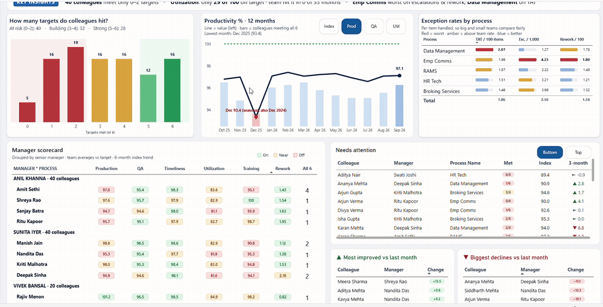
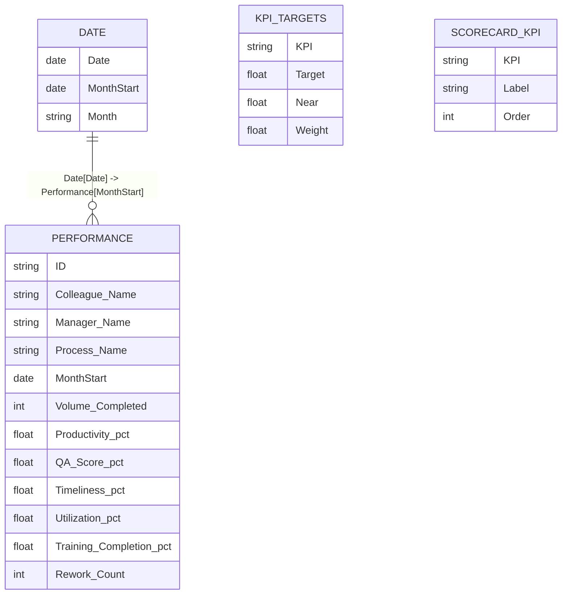
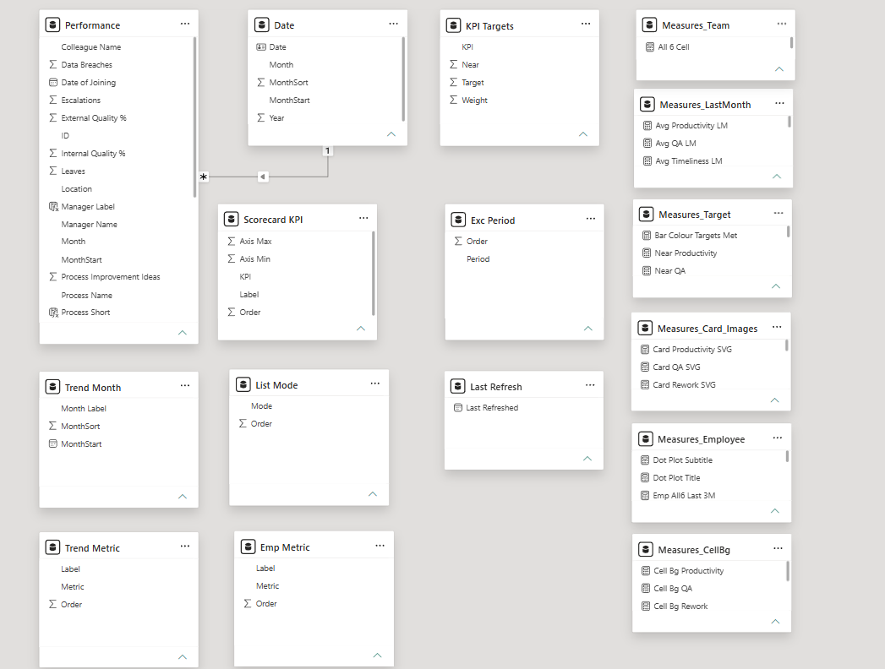
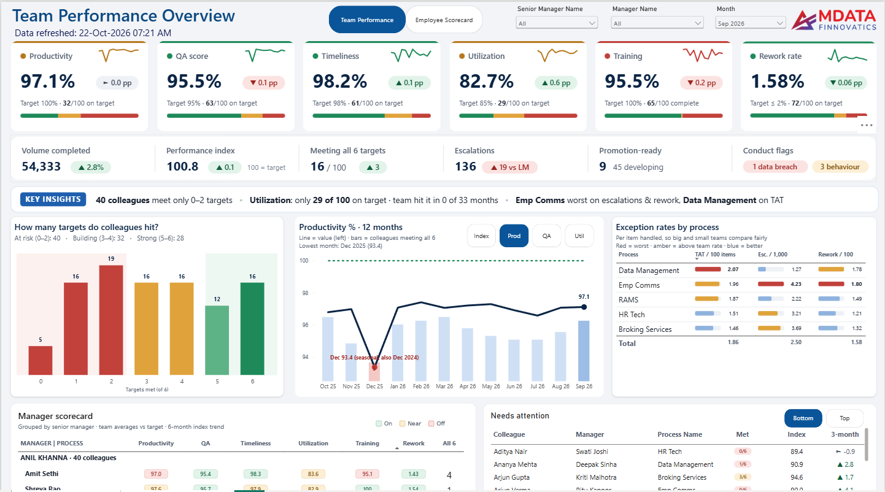
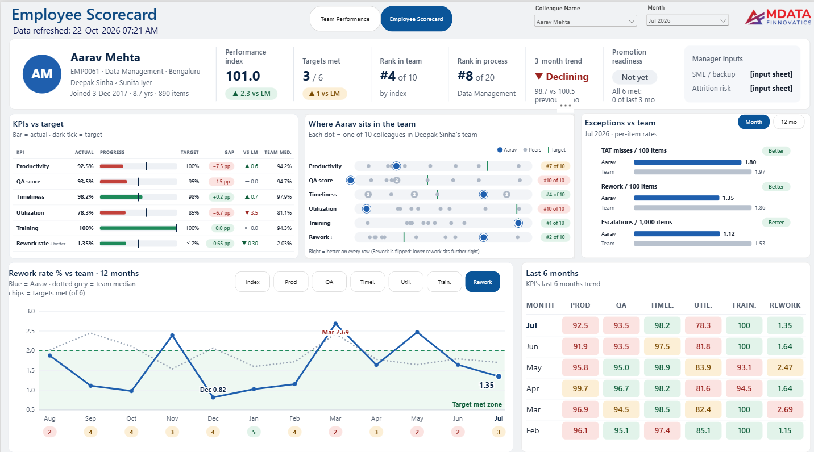

<div align="center">

# Team Performance & Employee Scorecard Dashboard

### A 2-page Power BI report that tells managers in 5 seconds where to act: team KPIs against target, who is at risk, who is promotion-ready, and a one-click scorecard for every employee.


</div>

<p align="center">
  
</p>

---

## 📑 Table of Contents

- [Project Overview](#-project-overview)
- [Business Problem](#-business-problem)
- [Dataset](#-dataset)
- [Data Model](#-data-model)
- [Dashboard Walkthrough](#-dashboard-walkthrough)
- [Business Rules](#-business-rules)
- [Key Features & Design Decisions](#-key-features--design-decisions)
- [Technical Approach](#-technical-approach)
- [Key Insights](#-key-insights)
- [How to Explore This Project](#-how-to-explore-this-project)
- [Repository Structure](#-repository-structure)
- [Skills Demonstrated](#-skills-demonstrated)
- [Contact](#-contact)

---

## 📌 Project Overview

A redesign of a plain 2-page performance report into a manager-ready Power BI dashboard. It covers the full workflow: **Power Query → data model → DAX business rules → custom visual design → user documentation**.

| Metric | Value |
|---|---|
| 👥 Colleagues | **100** |
| 🧑‍💼 Managers / Senior managers | **10 / 3** |
| 🏢 Processes / Locations | **5 / 5** |
| 📅 Period | **Jan 2024 – Sep 2026 (33 months)** |
| 🧾 Rows (colleague × month) | **3,300** |
| 🎯 KPIs tracked against target | **6** |
| 📄 Report pages | **2** (Team Performance Overview + Employee Scorecard) |

> **Note:** all names and figures are **synthetic sample data** created for this portfolio project.

---

## 🎯 Business Problem

Operations managers had monthly KPI numbers but no quick way to see **where to act**. Averages hid people who were off target, and appraisal or promotion talks relied on opinion.

**Questions this report answers:**

1. Which KPIs is the team missing this month, and how many people are off target on each?
2. Which **process** has the worst TAT-miss, escalation and rework rates?
3. Which **managers' teams** are strong or weak, and how are they trending?
4. **Who is at risk** (0–2 targets met) and **who is promotion-ready**?
5. For any one employee: rank in team, 12-month trend vs team, and **what to discuss in their 1:1**?

---

## 🗂️ Dataset

| Source | Description | Rows |
|---|---|---|
| `data/Data_File.xlsx` (sheet *Data*) | One row per colleague per month | 3,300 |

**Columns:** `ID`, `Colleague Name`, `Manager Name`, `Senior Manager Name`, `Process Name`, `Location`, `Date of Joining`, `Volume Completed`, `Productivity %`, `Utilization %`, `QA Score %`, `Timeliness %`, `Training Completion %`, `TAT Miss Count`, `Escalations`, `Rework Count`, `Internal Quality %`, `External Quality %`, `Data Breaches`, `Unprofessional Behaviour`, `RTO (Return to Office)`, `Leaves`, `Process Improvement Ideas`, `Month`, `Year`

**Power Query steps:** promoted headers, set data types, built a `MonthStart` date from `Month` + `Year` for the relationship to the Date table.

---

## 🧩 Data Model

One fact table, a DAX date table, a business-rules table and small disconnected helper tables for buttons and visual rows. All measures live in a dedicated `_Measures` table.



| Helper table (not related) | Used for |
|---|---|
| `KPI Targets` | Target, "near" band and index weight for each KPI. Change a target here and every colour updates |
| `Trend Month`, `Trend Metric` | Page 1 12-month chart axis and Index / Prod / QA / Util buttons |
| `List Mode` | Bottom / Top buttons on the Needs attention list |
| `Scorecard KPI` | The 6 rows drawn in the Page 2 KPI table, dot plot and heatmap |
| `Emp Metric`, `Exc Period` | Page 2 chart buttons |

<p align="center"></p>

---

## 📊 Dashboard Walkthrough

### 1️⃣ Team Performance Overview

<p align="center"></p>

- **6 KPI cards**: team value vs target and last month, 12-month sparkline, and a **people bar** (on / near / off target)
- **Operations strip**: volume, Performance Index, colleagues meeting all 6 targets, escalations, promotion-ready, conduct flags
- **Key insights bar**: 3 sentences written automatically from the data
- **How many targets do colleagues hit?** 0–6 distribution with at-risk and strong zones
- **12-month trend** with metric buttons; lowest month flagged in red
- **Exception rates by process**: per-item rates with in-cell bars
- **Manager scorecard**: coloured KPI pills, grouped by senior manager, 6-month trend line
- **Needs attention / Top performers** and **Biggest movers**

### 2️⃣ Employee Scorecard (drill-through)

<p align="center"></p>

- **Profile strip**: index, targets met, rank in team and process, 3-month trend, promotion readiness
- **KPIs vs target**: progress bar with target tick, gap chip, vs last month, team median
- **Where they sit in the team**: dot plot of every teammate on each KPI, with rank chips
- **12-month trend vs team median**, with targets-met chips under each month and KPI buttons
- **Exceptions vs team** (month / 12-month toggle) and a **6-month heatmap**

Right-click any colleague on Page 1 → **Drill through → Employee scorecard**.

---

## 📏 Business Rules

| KPI | Target | Amber ("near") | Weight in index |
|---|---|---|---|
| Productivity | ≥ 100% | within 3 pp | 30% |
| QA score | ≥ 95% | within 1 pp | 25% |
| Timeliness | ≥ 98% | within 0.5 pp | 15% |
| Utilization | ≥ 85% | within 3 pp | 15% |
| Rework rate | ≤ 2% (lower is better) | within 0.5 pp | 10% |
| Training completion | 100% | within 3 pp | 5% |

- **Performance Index** = 100 × Σ (weight × actual ÷ target); Rework uses target ÷ actual, capped at 1.5. **100 = exactly on target.** Team index = average of colleague indexes.
- **At risk** = 0–2 targets met.
- **Promotion-ready** = all 6 met in ≥ 2 of the last 3 months, ≥ 2 years' tenure, no conduct flag in 6 months. **Developing** = not ready but 3-month index ≥ 100.
- **3-month trend** = last 3 months' average index vs the 3 months before (±1 point = stable).

---

## ✨ Key Features & Design Decisions

| Feature | Why |
|---|---|
| 🟢🟠🔴 **One 3-tier colour rule everywhere** | The same green / amber / red logic on cards, pills, chips and heatmap, so users learn it once |
| 👥 **People bar on every KPI card** | A 97% average can hide 40 people off target; the bar shows the spread |
| 🖼️ **SVG image measures** | Bullet bars, pills, dot plots, sparklines and chips drawn in DAX. No custom visuals, so nothing to license or break |
| ✍️ **Auto-written insights** | The key-insights bar describes the weakest KPI and the worst process in plain English |
| 🔍 **Drill-through scorecard** | Page 1 answers "where?", Page 2 answers "who and why?" |
| ⚖️ **Rates, not counts** | Exceptions per 100 / 1,000 items, so big and small teams compare fairly |
| 📐 **Medians for team comparison** | One outlier does not distort the benchmark |
| 🎛️ **Business rules in a table** | Targets, bands and weights edited in one place, with no DAX changes needed |
| 📘 **User Read Me** | Plain-language guide for managers in `docs/` |

---

## 🧮 Technical Approach

| Area | What was built |
|---|---|
| **Performance Index** | A weighted composite of 6 KPIs (attainment ÷ target × weight), with a capped inverse for Rework because lower is better. Calculated per colleague, then averaged for the team |
| **Targets met and status** | Each KPI checked against its target and tolerance band to give green / amber / red, plus a 0–6 targets-met count per colleague |
| **Promotion readiness** | Rolling 3-month and 6-month windows combined with tenure and conduct checks |
| **Ranking and benchmarks** | Rank in team and process, team medians, and month-on-month change, all respecting the Month slicer |
| **Time intelligence** | Last-month comparisons, rolling 3-month trends, 12-month windows ending on the selected month |
| **Custom visuals with SVG in DAX** | KPI pills, bullet bars, dot plots, sparklines, chips and heatmaps drawn as SVG images by DAX measures, with no custom visuals to license or maintain |
| **Auto-generated text** | Key insights and coaching notes written in plain English from the data |
| **Usability** | Drill-through, synced slicers, button slicers, dynamic titles and subtitles |

> The `.pbix` file is not included in this repository. For a live demo or a walkthrough of the build, [get in touch](#-contact).

---

## 💡 Key Insights

> From the sample data, Sep 2026.

- ⚠️ **40 of 100 colleagues are at risk**, meeting only 0–2 of the 6 targets, even though the team averages look close to target.
- 📉 **Utilization is the weakest KPI**: only 29 of 100 colleagues are on target, and the team average has missed 85% in all 33 months.
- ✅ **16 colleagues meet all 6 targets**; team Performance Index is **100.8** (just above target).
- 🚩 **Emp Comms** has the worst escalation rate (4.23 per 1,000 items) and rework rate (1.80 per 100); **Data Management** the worst TAT-miss rate (2.07 per 100).
- 🎄 **December dips are seasonal**: productivity was lowest in Dec 2025, and Dec 2024 was also the low point that year.
- 🎯 **9 colleagues are promotion-ready** and 45 more are developing.

---

## 🚀 How to Explore This Project

1. Watch the walkthrough at the top of this page.
2. Look through the page screenshots in [`images/`](images).
3. Read the user guide: [`docs/Read_Me.docx`](docs/Read_Me.docx). It explains every section and rule in plain language.
4. The sample data is in [`data/Data_File.xlsx`](data/Data_File.xlsx).

**Using the report (for clients):**
- Pick a **Month** (one at a time). It is shared by both pages.
- Use **Senior manager / Process / Manager** slicers to narrow Page 1.
- Right-click a colleague → **Drill through → Employee scorecard**, or pick a name on Page 2.

---

## 📁 Repository Structure

```
📦 team-performance-dashboard-power-bi
 ┣ 📜 README.md
 ┣ 📂 data
 ┃ ┗ 📄 Data_File.xlsx                  # Synthetic sample data
 ┣ 📂 docs
 ┃ ┗ 📄 Read_Me.docx                    # User guide for both pages
 ┗ 📂 images
   ┣ 🎞️ demo.gif
   ┣ 🖼️ page1_team_overview.png
   ┣ 🖼️ page2_employee_scorecard.png
   ┗ 🖼️ data_model.png
```

---

## 🧠 Skills Demonstrated

- **KPI design**: targets, tolerance bands, weighted composite index, promotion rules
- **Data modelling**: fact + date table, disconnected helper tables, measure table
- **Advanced DAX**: weighted indexes, rolling windows, time intelligence, ranking, medians and dynamic text
- **Custom visuals with SVG in DAX**: bullet bars, pills, dot plots, sparklines, heatmaps
- **Dashboard UX**: drill-through, synced slicers, button slicers, dynamic titles, page navigation
- **Business storytelling**: auto-generated insights and coaching notes
- **Documentation**: user-facing Read Me

---

## 📬 Contact

**Pradeep Kumar** | Founder, Mdata Finnovatics | Power BI & Excel Automation Consultant

[](https://mdatafinnovatics.com)
[](https://www.linkedin.com/in/pradeepkumar777)
[](mailto:support@mdatafinnovatics.com)

---

<div align="center">

⭐ **If you found this project useful, please give it a star!** ⭐

</div>
